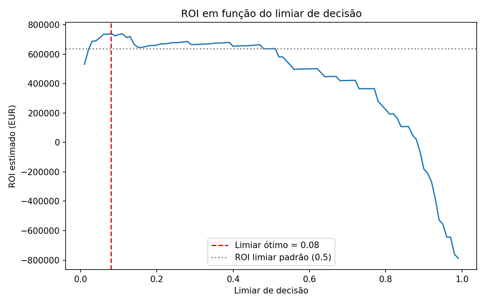
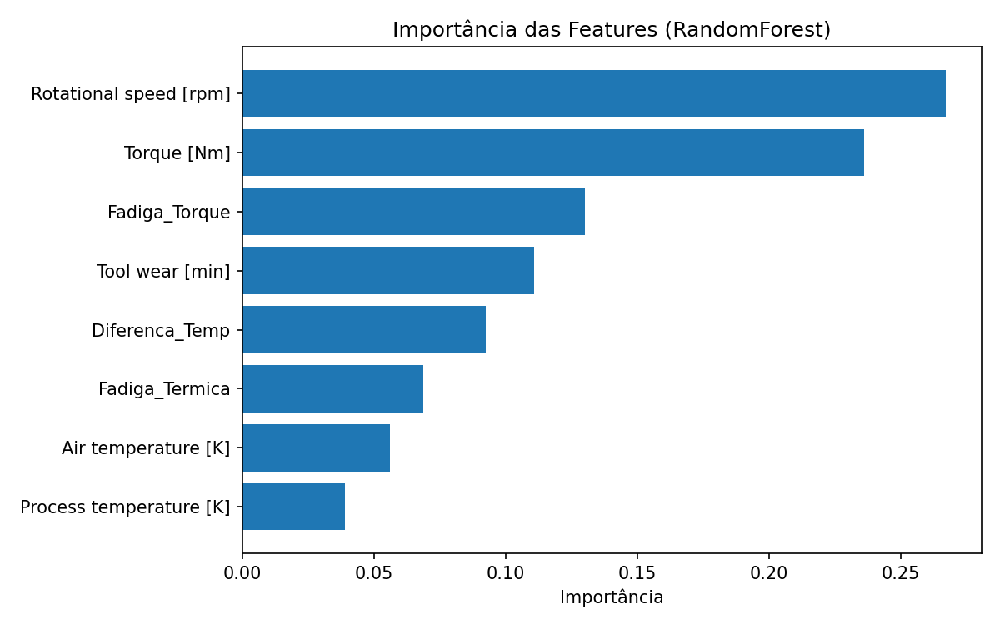

# Predictive Maintenance for Industrial Machinery

An end-to-end machine learning pipeline that predicts equipment failure from
sensor data and translates the prediction into a **financial decision**,
not just a classification score.

Built as a personal project to combine an Industrial Engineering & Management
background with applied ML.

Dataset: [Machine Predictive Maintenance Classification](https://www.kaggle.com/datasets/shivamb/machine-predictive-maintenance-classification) (Kaggle)

## Why this project is different from a typical classification exercise

Most predictive maintenance tutorials stop at accuracy/F1-score. In a real
factory, a false alarm and a missed failure do **not** cost the same amount
of money — so optimizing a generic classification metric doesn't actually
optimize the business outcome. This project treats the model's decision
threshold as a **cost-optimization problem**, not just a probability cutoff.

## Approach

1. **Feature engineering from mechanical domain knowledge**
   Instead of feeding raw sensor readings directly into the model, engineered
   features that reflect accumulated mechanical fatigue:
   - `Fadiga_Torque` = Torque × Tool wear
   - `Fadiga_Termica` = (Process temp − Air temp) × Tool wear

   These turned out to be the two most important predictors in the final
   model (see `feature_importance.png`) — evidence the domain-informed
   features add real signal, not just complexity.

2. **Handling class imbalance correctly**
   Failures are rare events. Used a stratified train/test split (so the
   failure rate is preserved in both sets) and applied SMOTE oversampling
   **only on the training set**, avoiding data leakage into the test set.

3. **Model comparison via cross-validation**
   Compared RandomForest, Logistic Regression, and Gradient Boosting using
   5-fold stratified cross-validation instead of a single train/test split,
   to avoid picking a model that just got a lucky split.

4. **Cost-sensitive threshold optimization**
   Rather than using the default 0.5 probability threshold, swept all
   thresholds and selected the one that maximizes estimated financial ROI,
   using illustrative cost assumptions:

   | Outcome | Cost / Benefit | Rationale |
   |---|---|---|
   | False Positive | −€500 | Unnecessary preventive inspection (labor + short downtime) |
   | False Negative | −€15,000 | Undetected failure → unplanned downtime, emergency repair, lost production |
   | True Positive | +€14,000 | Net savings from catching the failure early via planned maintenance |

   These are illustrative estimates based on typical SME manufacturing
   maintenance costs; in a real deployment they would be replaced with the
   factory's own historical cost data.

5. **Feature importance analysis**
   Extracted and visualized feature importances from the final model to
   confirm which sensor readings actually drive the prediction — useful
   both for interpretability and for validating the engineered features.

## Results

**Model comparison (5-fold stratified cross-validation, F1-score):**

| Model | F1 (mean ± std) |
|---|---|
| RandomForest | **0.979 ± 0.003** |
| GradientBoosting | 0.948 ± 0.002 |
| LogisticRegression | 0.847 ± 0.009 |

RandomForest was selected as the final model — highest F1 with the lowest
variance across folds, indicating a stable result rather than a lucky split.

**Financial impact of threshold optimization:**

| Threshold | Estimated ROI |
|---|---|
| Default (0.50) | €637,000 |
| Optimized (0.08) | **€740,500** |
| **Gain from optimization** | **+€103,500** |

Optimizing the decision threshold against the cost-sensitive ROI function —
instead of using the default 0.5 cutoff — captured an additional €103,500
in estimated avoided downtime cost on the test set. This is the practical
payoff of framing the problem financially rather than purely as a
classification task.



**Feature importance:**

| Feature | Importance |
|---|---|
| Rotational speed [rpm] | 0.267 |
| Torque [Nm] | 0.236 |
| Fadiga_Torque (engineered) | 0.130 |
| Tool wear [min] | 0.111 |
| Diferenca_Temp (engineered) | 0.092 |
| Fadiga_Termica (engineered) | 0.069 |
| Air temperature [K] | 0.056 |
| Process temperature [K] | 0.039 |

Rotational speed and torque are the strongest individual predictors, which
lines up with the mechanical failure modes in the dataset (overstrain and
power failure are driven by torque/speed combinations). The engineered
fatigue features still contribute meaningfully — together they account for
about 20% of total importance — but the raw sensor readings carry more
signal on their own than initially expected.



## Project structure

```
├── main.py                  # Orchestrates the full pipeline
├── src/
│   ├── data_prep.py         # Loading, feature engineering, SMOTE balancing
│   ├── train.py             # Model comparison (CV) + final training + feature importance
│   └── evaluate.py          # Cost-sensitive ROI calculation + threshold search
├── data/raw/                # Place predictive_maintenance.csv here
├── images/                  # Charts referenced in this README
├── requirements.txt
└── README.md
```

## Running it

```bash
pip install -r requirements.txt
# Download the dataset from Kaggle and place it at:
# data/raw/predictive_maintenance.csv
python main.py
```

This will print the model comparison results, the ROI at the default vs.
optimized threshold, the feature importance ranking, and save two charts
directly to `images/` (`feature_importance.png` and `roi_vs_limiar.png`),
overwriting the ones already shown in this README.

## Possible next steps

- Replace illustrative cost assumptions with real maintenance cost data
- Add SHAP values for per-prediction interpretability
- Try a survival-analysis / time-to-failure framing instead of binary
  classification, to estimate *when* a failure is likely, not just *if*
- Wrap the trained model in a simple API (FastAPI) for deployment
